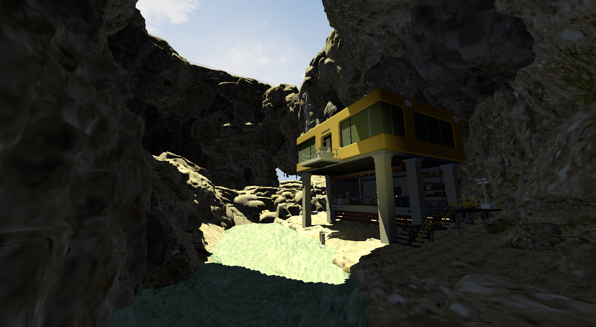
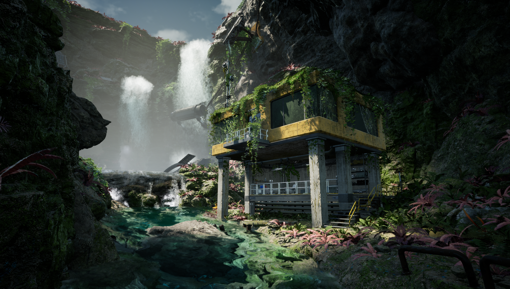

## Pet-Project-vk version 0.2.4
### Goals
**This project serves as an in‑depth exploration of low‑level graphics programming: I’m porting my [custom engine](https://github.com/indoostrialniy/Pet-project) to Vulkan and recreating a UE5‑level scene that I worked on for some time to strengthen my skills and portfolio. Currently in progress.**

### Current footages v0.2.4

### Target quality level

### Launch
**Download latest release, unpack, run executable.**

### Stack:
  Vulkan 1.1

  GLFW 3.5
  
  GLM 0.9.9
  
  Blender3D 4.0.2
  
  [CEAE v0.5.0]( https://github.com/indoostrialniy/CEAE)
